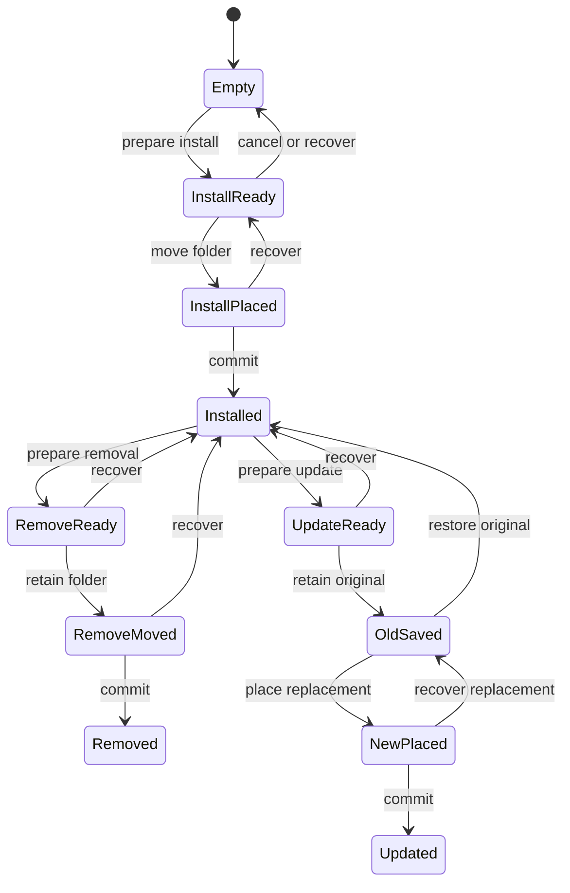
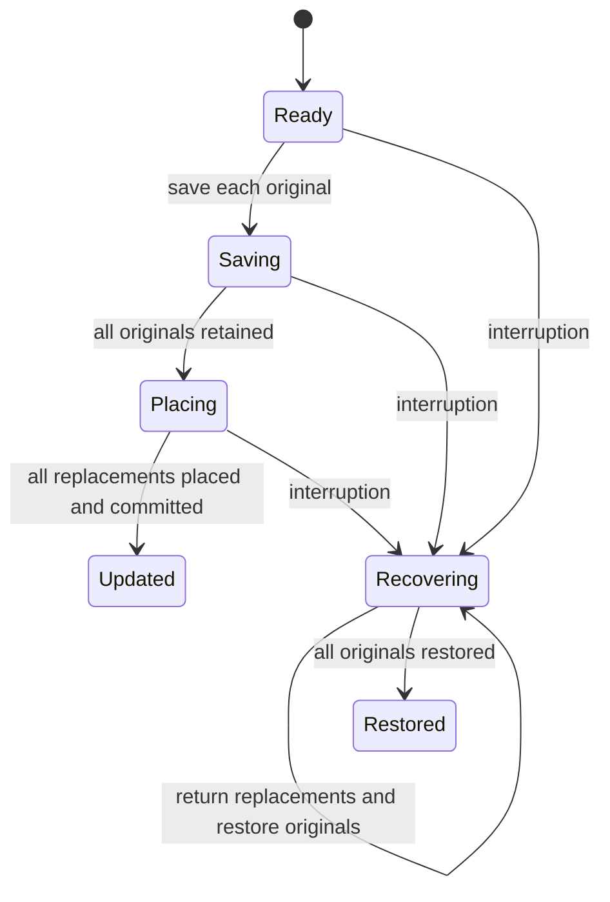
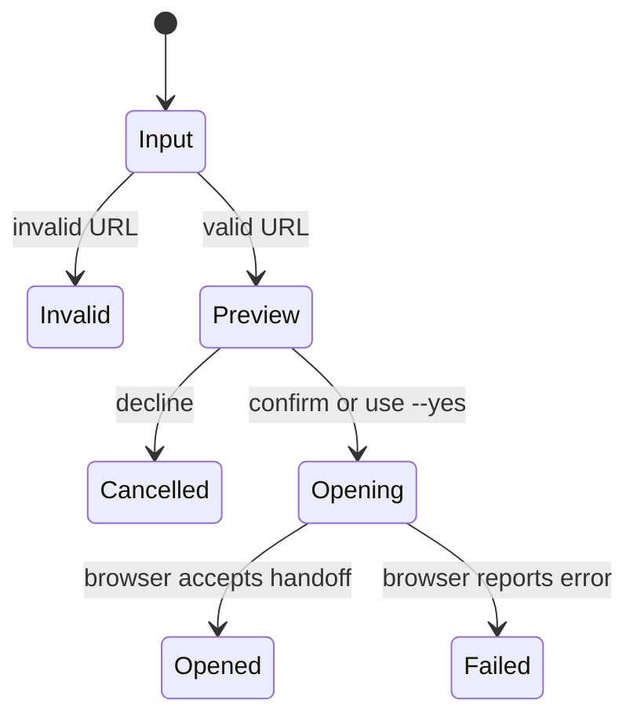

# Lifecycle models

Saved checker logs replace absolute local paths with `<model-check>/` and omit machine details. Model rules, counterexample steps, state counts, and check outcomes are preserved.

## Review fixes (2026-11-06)

Two new models captured bugs reproduced against the real Windows implementation before fixing it:

- `InstallationScope.tla`: `SameInstallation` requires every write to target the selected installation. The [pre-fix trace](reports/InstallationScope-before.out) is **1 Initial -> 2 Redirect -> 3 Preview -> 4 Confirm -> 5 Apply**: an `Interface` junction redirected installation into another game folder. The implementation now checks both `Interface` and `Interface/AddOns` before preview and execution. `refuses_redirected_installation_before_preview` and `refuses_redirected_installation_after_preview` replay both timings with real junctions and require the other installation to remain untouched.
- `RecoveryPreflight.tla`: `HonestPreview` requires a successful recovery preview to reflect valid files. The [pre-fix trace](reports/RecoveryPreflight-before.out) is **1 Initial -> 2 ChangeFiles -> 3 Preview**: a recovery dry run accepted changed backups. Preview and execution now share read-only recovery planning, with execution repeating it under the lock. `recovery_dry_run_reports_changed_files_without_writing` and `recovery_rechecks_contents_after_preview` check changes before and after preview against an interrupted two-folder update.

The fixed [installation-scope report](reports/InstallationScope/report.md) checks 10 distinct states and 14 transitions; its [generated chart](reports/InstallationScope/chart.mmd) has six states. The fixed [recovery-preflight report](reports/RecoveryPreflight/report.md) checks eight distinct states and 12 transitions; its [generated chart](reports/RecoveryPreflight/chart.mmd) has five states. All invariants and deadlock checks pass. Each chart omits six same-label transitions, including external file/path changes and terminal self-loops; TLC still checks them.

These models abstract filesystem links into a selected/redirected location and file integrity into a matching/changed flag. They cover changes before and after preview, with observation and application treated as atomic. They do not prove filesystem behavior, changes by external programs during individual operations, power-loss durability, or the Rust implementation. Regression tests establish the corresponding behavior on real temporary Windows installations.

## Preview and recovery selection checks (2026-11-06)

`Plan.tla` models a captured installation and input revision, confirmation or cancellation, dry runs, changes to inputs or defaults, and apply/refuse. `RecoveryChoice.tla` models zero, one, or multiple interrupted operations, explicit selection, preview, journal changes, and confirmed recovery. The generated charts use reader-facing labels from their `.view.mjs` files.

- [Plan report](reports/Plan/report.md) and [generated chart](reports/Plan/chart.mmd): 21 distinct states, 37 transitions. Confirmation, installation binding, input freshness, read-only previews, and no deadlocks hold.
- [Recovery selection report](reports/RecoveryChoice/report.md) and [generated chart](reports/RecoveryChoice/chart.mmd): 41 distinct states, 66 transitions. Known-operation selection, confirmation, unchanged journals, installation binding, no ambiguous writes, and no deadlocks hold.
- [Negative control](reports/negative-control.out): deliberately removing the apply freshness guard violates `FreshInputsRequired`: **1 Ready -> 2 Preview -> 3 Inputs change -> 4 Confirm -> 5 Apply**. This is an intentionally faulty model, not the implementation. `prepared_changes_reject_stale_archives_packages_and_new_conflicts`, `update_rejects_a_stale_confirmed_package`, and the stale-journal test replay the corresponding inputs against Rust and require refusal.

The charts omit transitions that remain in one displayed state: 20 for Plan and 37 for RecoveryChoice, including terminal self-loops and input/default changes. Those changes are checked by TLC, and their effects appear on the apply/refuse arrows.

These bounded models abstract hashing into revision equality and recovery into a successful operation. They assume atomic observation/execution boundaries and exclusive Wowza writers during mutation; they do not prove Rust, authentication, power-loss durability, external-manager behavior, usability, or eventual progress amid conflicts. Detailed folder movement remains covered by `Update.tla` and real Windows process-interruption tests. A library caller authorizes a change by explicitly calling `execute`; CLI authorization comes from confirmation or `--yes`.

## Reproduce the checks

All seven models, both pre-fix counterexamples, and the negative control run with Java 11+ and the TLA+ 1.7.4 JAR. Node and Codex skills are not required. From the project root, choose a **new scratch folder outside the repository**:

```powershell
.\scripts\check-models.ps1 -TlaTools 'C:\path\to\tla2tools.jar' -OutputDirectory "$env:TEMP\wowza-model-check-new"
```

The JAR SHA-256 used here is `936a262061c914694dfd669a543be24573c45d5aa0ff20a8b96b23d01e050e88`. The runner invokes TLC directly, writes one `<model>.out` log per model, and requires all current invariants and deadlock checks to pass. Counterexamples must return the expected failure exit code and name the original violated invariant. Each TLC run has its own state directory. Omit `-OutputDirectory` to create a unique temporary folder automatically.

The four generated charts and reports are checked in under `reports/`. Regenerating them is optional and additionally requires Node supported by the statechart skill and a local copy of that skill's scripts:

```powershell
.\scripts\check-models.ps1 -TlaTools 'C:\path\to\tla2tools.jar' -StatechartScripts 'C:\path\to\statechart\scripts'
```

This option checks the same models, then writes charts and reports under `<output>/<model>/done/`. It invokes the statechart worker directly because the skill's shell launcher requires `/bin/sh` on native Windows. Pre-fix counterexamples still use plain TLC because the worker cannot parse their native Windows error output.

## Folder lifecycle and browser handoff

The authoritative implementation is `src/manage.rs` and the CLI in `src/cli.rs`. These finite models abstract individual folder moves as atomic and assume exclusive Wowza access, successful filesystem operations except at the modeled interruption points, and no external changes. They do not prove the Rust implementation, power-loss durability, game behavior, archive authenticity, or progress when conflicts persist. `scan`, `list`, `doctor`, and `inspect-archive` are read-only observations rather than persistent state transitions.

`Lifecycle.tla` models install, remove, update and recovery for one folder. `Update.tla` explores two folders and recovery between moves. `Handoff.tla` models URL rejection, confirmation (including explicit `--yes`), cancellation, and opening/failure; opening is not installation. TLC found no invariant violations: 11, 16 and 7 distinct states respectively. Each run used one worker and exhausted the model's reachable state space, not the real system's state space.







The charts are manually transcribed from the models: terminal self-loops and repeated per-folder transitions are condensed. In the actual implementation confirmation precedes staging, and the journal is published after staging. The model's ready states abstract that preparation. Tests in `src/manage.rs` exercise all nine combinations of two-folder update positions, including a failed recovery followed by retry; `tests/archive_cli.rs` exercises the public CLI and backup. The handoff model assumes the operating system reports opening correctly; it cannot establish that a browser displayed the page or an add-on was installed.

The runner described above includes these three models. The original folder/handoff results used TLC directly; their charts above are manually transcribed. The checked-in preview and recovery-selection reports used the statechart generator through the optional Windows-compatible worker route described above.
